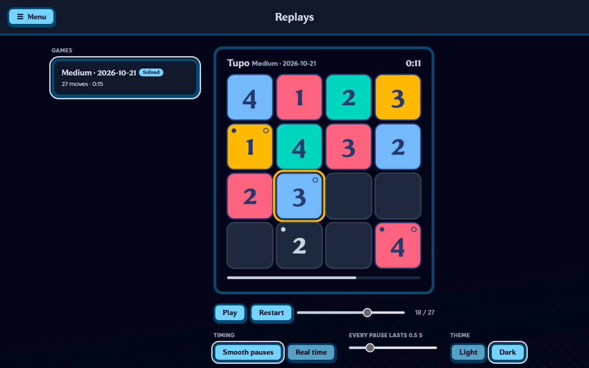

# Tupo Replay

A Firefox extension for [playtupo.com](https://playtupo.com): it records every move of your solo games
(mistakes and erasures included) and turns them into an animated GIF.

Unofficial, not affiliated with Tupo.

## Why

Finishing a Tupo puzzle only leaves you with a time and a text to copy. The interesting part, how you got
there, the wrong guess you erased, the moment it clicked, is gone. Tupo Replay keeps that story and lets you
share it as a GIF.

## Screenshot / GIF



<!-- TODO: add an exported replay GIF here. -->

## How it works

- **Recording**: Tupo saves the game state in `localStorage` (`tupo:progress:<hash>`) on every move, with its
  timer (`elapsedMs`). The content script re-reads these keys whenever the page changes (and at least once per
  second) and keeps the difference with the previous state. It only **reads**: no Tupo script is intercepted
  and nothing is written to the page storage.
- **Game time**: the replay follows Tupo's timer, not the wall clock. Hidden tab, unfocused window, pause
  button: Tupo stops its timer, so pauses do not exist in the replay. Tupo's timer moves in 250 ms steps; when
  the wall clock and the timer agree (less than 500 ms apart), the more precise wall-clock gap is kept.
- **End of game**: when the result shows up in `tupo:results`, the recording becomes "Solved" with the official time.
- **Game started before installing**: the replay starts from the state found, marked "Partial".
- **Storage**: the extension's `browser.storage.local` (`rec:<id>`). Nothing is sent over the network.

## The replays page

`playtupo.com/?replay`: the content script runs at `document_start`, calls `window.stop()` before Tupo's app
starts, then redraws the header and menu with Tupo's own classes and stylesheets. No Tupo script runs on this
page, so your saved game is never touched. `?replay=<id>` opens a game directly.

## Usage

- Tupo menu, **Replay** section, or the **Replay GIF** button in the "Solved!" dialog: the page opens in the same
  tab. The extension icon opens it too (in the current tab if it is on Tupo, otherwise in a new tab).
- **Smooth pauses**: every pause between two moves lasts the same (0.5 s by default, adjustable from 0.1 to 2 s),
  whether you took 1 ms or 10 minutes.
- **Real time**: the actual timeline, to scale, at 1× to 30× speed.
- Light or dark theme, then **Export GIF**. The GIF shows Tupo's timer, the played cell outlined, the starting
  clues (dot = given digit, circle = given color) and a progress bar.

## Installation

Until it is available on addons.mozilla.org, load it as a temporary add-on:

```sh
pnpm install
pnpm build
```

Then `about:debugging#/runtime/this-firefox` → "Load Temporary Add-on…" → `dist/manifest.json`.

Requires Firefox 128 or later.

## Development

```sh
pnpm install
pnpm test        # recorder + timeline (vitest)
pnpm typecheck
pnpm build       # -> dist/ + web-ext-artifacts/tupo-replay-<version>.zip (+ -source.zip of the last commit)
pnpm lint        # web-ext lint
pnpm e2e         # headless Firefox: plays the daily puzzle on playtupo.com and exports the GIF
pnpm store       # store/: PNG icons (128, 64) and 1280×800 light and dark screenshots for AMO
```

`e2e` uses a throwaway profile: your Firefox profile is never touched. It solves the daily puzzle, makes a
deliberate mistake, simulates a 5 s focus loss, wins, then checks the recording and the GIF. Screenshots and GIF
go to `e2e/screenshots/`. It builds with `--e2e` (a test hook into the recordings, absent from the normal build),
then rebuilds normally at the end.

## Publishing on addons.mozilla.org

- Extension: `web-ext-artifacts/tupo-replay-<version>.zip`. Bump `version` in `package.json` before each upload.
- Sources (AMO asks for them for bundled code): `web-ext-artifacts/tupo-replay-<version>-source.zip`, taken from
  the last commit. Commit before building. To rebuild: `pnpm install && pnpm build`.
- Listing: `store/icon-128.png` and `store/screenshot-light.png` / `store/screenshot-dark.png`.
- The test build (`--e2e`) never produces a zip.

## License

[MIT](LICENSE) © JonesJugHead
